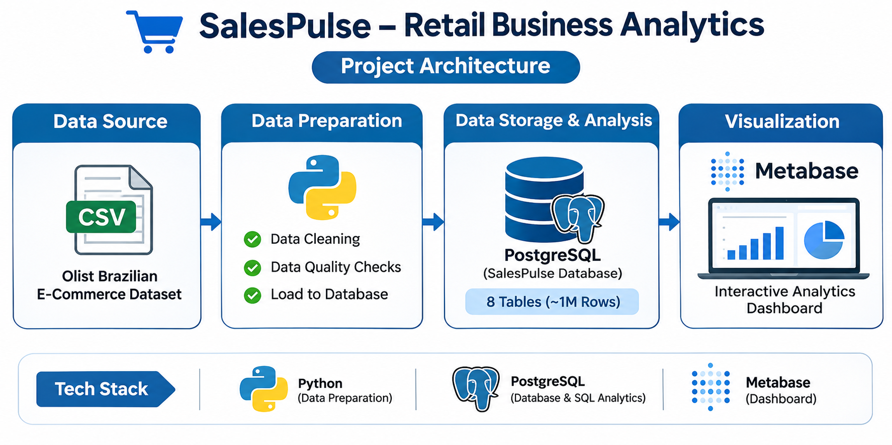
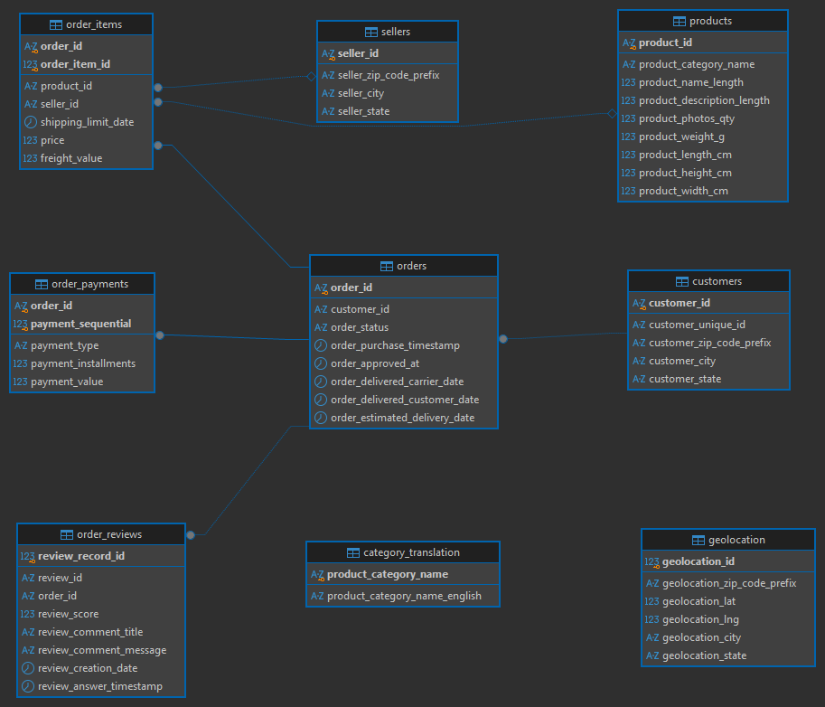
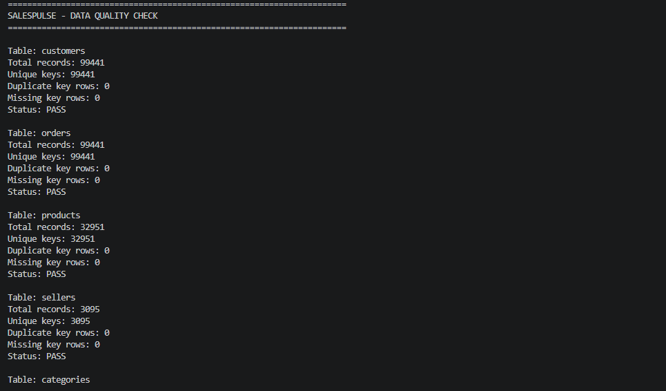
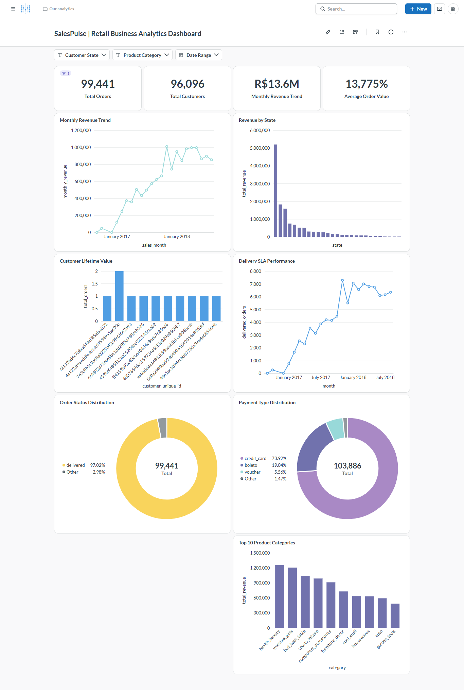
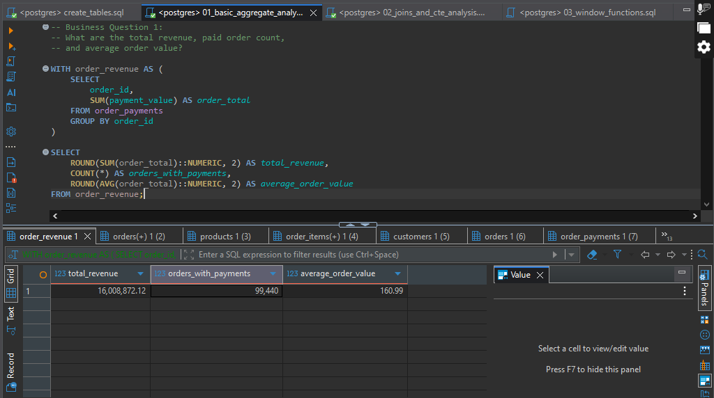
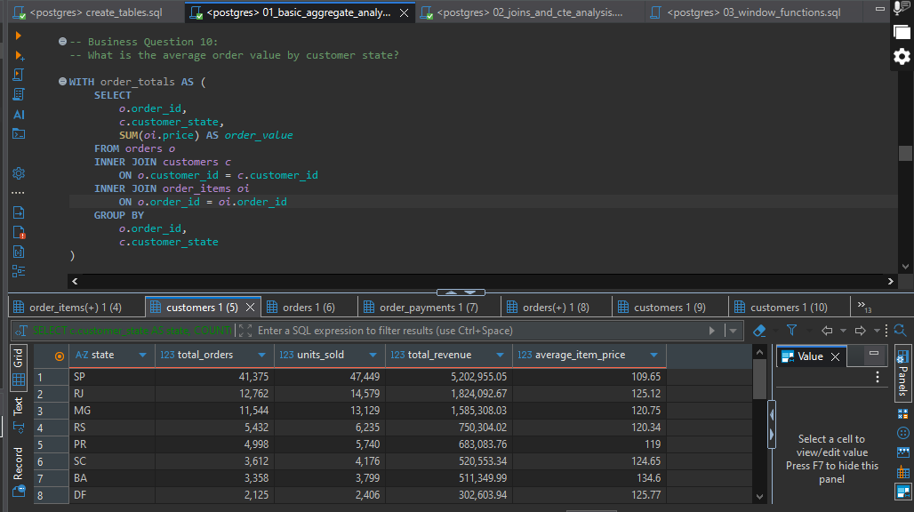
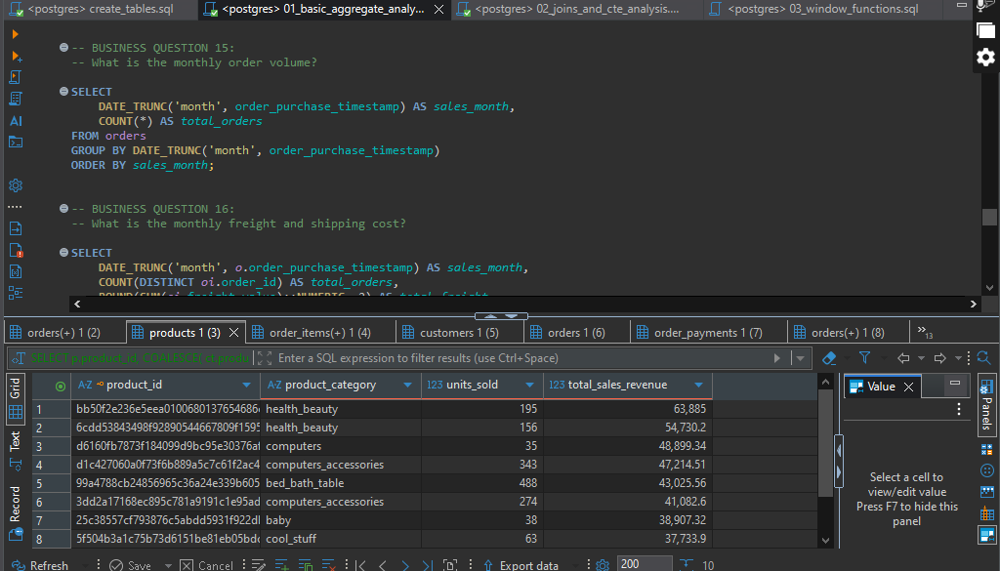

# SalesPulse — Retail Business Analytics with SQL & Metabase

[](https://www.postgresql.org/)
[](https://www.python.org/)
[](https://dbeaver.io/)
[](https://www.metabase.com/)
[](https://youtu.be/JfchSQo9VEQ)
[](LICENSE)
[]()

> An enterprise-grade retail business analytics platform modeling 100,000+ Brazilian e-commerce orders. Features **PostgreSQL 17** / **Neon Serverless PostgreSQL**, Python 3.12 batch ETL pipelines, 56 commercial SQL analyses, join validation proofs, 4 analytical views, and an interactive executive **Metabase BI Dashboard**.

📺 **Video Demonstration**: [Watch SalesPulse Project Demo on YouTube (2:45)](https://youtu.be/JfchSQo9VEQ)
🚀 **Deployment Guide**: [Cloud Deployment Guide (PostgreSQL & Metabase)](DEPLOYMENT.md)
📖 **Data Dictionary**: [Complete Relational Schema & 9-Table Catalog](DATA_DICTIONARY.md)
📊 **Executive Summary**: [C-Suite Business Insights & Recommendations](docs/executive_summary.md)
📈 **Metabase Dashboard**: `[METABASE_PUBLIC_DASHBOARD_URL_PLACEHOLDER]`

---

## 3. Table of Contents

1. [Project Title and Overview](#1-project-title-and-overview)
2. [Project Badges and Live Links](#2-project-badges-and-live-links)
3. [Table of Contents](#3-table-of-contents)
4. [Business Context and Executive Overview](#4-business-context-and-executive-overview)
5. [Objectives and Analytical Scope](#5-objectives-and-analytical-scope)
6. [Dataset Architecture and Relational Entities](#6-dataset-architecture-and-relational-entities)
7. [System Architecture](#7-system-architecture)
8. [Relational Database Schema and ERD](#8-relational-database-schema-and-erd)
9. [Data Cleaning, Validation and Anomaly Resolution](#9-data-cleaning-validation-and-anomaly-resolution)
10. [Master KPI Definitions and Ground Truth Table](#10-master-kpi-definitions-and-ground-truth-table)
11. [SQL Analysis Categories and Query Catalog](#11-sql-analysis-categories-and-query-catalog)
12. [Advanced SQL Techniques and Anti-Inflation Proofs](#12-advanced-sql-techniques-and-anti-inflation-proofs)
13. [Metabase Executive BI Dashboard](#13-metabase-executive-bi-dashboard)
14. [Strategic Business Insights and Recommendations](#14-strategic-business-insights-and-recommendations)
15. [Complete Visual Analytics Showcase](#15-complete-visual-analytics-showcase)
16. [Repository Directory Structure](#16-repository-directory-structure)
17. [Prerequisites and System Requirements](#17-prerequisites-and-system-requirements)
18. [Step-by-Step Local Setup and Database Ingestion](#18-step-by-step-local-setup-and-database-ingestion)
19. [SQL Suite Execution and Metabase Launch Guide](#19-sql-suite-execution-and-metabase-launch-guide)
20. [Limitations, Future Roadmap and Author Attribution](#20-limitations-future-roadmap-and-author-attribution)

---

## 1. Project Title and Overview

**SalesPulse — Retail Business Analytics with SQL & Metabase**
*A comprehensive retail intelligence warehouse and executive BI analytics platform modeling the Brazilian e-commerce marketplace.*

SalesPulse bridges the gap between raw, multi-table e-commerce transaction logs and executive decision-making. By combining a normalized **PostgreSQL 17** analytical warehouse with an interactive **Metabase BI** dashboard, SalesPulse delivers verified metrics on customer lifetime value, logistics SLAs, delivery sentiment penalties, and regional demand dynamics.

The core solution leverages:
- **PostgreSQL 17** for relational data warehousing and ACID integrity.
- **SQL (ANSI & PostgreSQL)** for deep commercial querying, window functions, and Pareto modeling.
- **Python 3.12** for automated schema profiling, anomaly resolution, and batch ingestion.
- **Metabase** for executive visual analytics, interactive filtering, and scorecards.
- **GitHub** for repository version control, schema documentation, and reproducible code.

---

## 2. Project Badges and Live Links

| Resource | Link / Badge | Description |
| :--- | :--- | :--- |
| **Source Code** | [](https://github.com/Awaisbacha55/SalesPulse-Retail-Business-Analytics) | Main open-source repository |
| **Walkthrough Video** | [](https://youtu.be/JfchSQo9VEQ) | 2:45 comprehensive video walkthrough |
| **Database Engine** | [](https://www.postgresql.org/) | Local PostgreSQL 17 & Neon serverless |
| **ETL & Validation** | [](https://www.python.org/) | Python batch loader & data profiler |
| **BI Dashboard** | [](https://www.metabase.com/) | Interactive Business Intelligence canvas |
| **Public Metabase** | `[METABASE_PUBLIC_DASHBOARD_URL_PLACEHOLDER]` | Live interactive executive dashboard |
| **Deployment Guide** | [`DEPLOYMENT.md`](DEPLOYMENT.md) | PostgreSQL & Metabase deployment instructions |
| **Data Catalog** | [`DATA_DICTIONARY.md`](DATA_DICTIONARY.md) | Entity, column, and constraint catalog |

---

## 4. Business Context and Executive Overview

The Brazilian e-commerce market is one of the largest and most complex digital retail ecosystems in Latin America. Operating as a marketplace integrator, **Olist** connects thousands of small-to-medium retail merchants to major Brazilian sales channels (such as Mercado Livre, B2W, and Magazine Luiza).

Managing a multi-sided marketplace presents significant operational and financial challenges:
- **Severe Geographic Transit Disparities**: Spanning over 8.5 million square kilometers, delivery transit times range from 8.8 days in the industrial Southeast to over 29 days in northern equatorial states.
- **The Delivery Delay Review Penalty**: Customer satisfaction collapses when estimated delivery dates are missed, directly degrading merchant review scores.
- **Customer Acquisition vs. Retention Imbalance**: High customer acquisition volume (96,000+ buyers) masks an acute repeat purchase deficit, where 96.88% of customers purchase only once.
- **Payment Method Preferences**: The dominance of credit cards (73.92% of payments) and multi-month installment financing shapes marketplace checkout conversion and cash collection cycles.
- **Catalog Revenue Concentration**: A minority of high-velocity product categories and SKUs drive the vast majority of gross merchandise value.

SalesPulse ingests, cleans, and interrogates **1,547,842 relational records** across **99,441 customer orders** to deliver empirical clarity to these core commercial questions.

---

## 5. Objectives and Analytical Scope

1. **Relational Schema Engineering**: Design and populate a 3rd-normal-form (3NF) relational warehouse in PostgreSQL 17 with strict primary keys, foreign key constraints, and analytical indexing.
2. **Data Profiling and Anomaly Resolution**: Detect and programmatically resolve real-world dirty data anomalies—specifically non-unique natural keys in customer reviews and misspelled column headers in upstream CSVs.
3. **Rigorous SQL Analytical Suite**: Develop and execute 56 verified SQL queries, including aggregate baselines, multi-table joins, modular CTEs, window functions (`LAG`, `ROW_NUMBER`, `RANK`, `DENSE_RANK`), Pareto distribution models, and join anti-inflation validation proofs.
4. **Executive Metabase BI Dashboard**: Construct an executive business intelligence command center with global date and state filters, interactive KPI cards, and SLA correlation charts.
5. **Ground-Truth KPI Harmonization**: Eliminate metric discrepancies by establishing unambiguous mathematical definitions for Merchandise GMV, Gross Payment Volume, Delivered Payment Revenue, and Basket AOV.
6. **Actionable Commercial Strategy**: Translate empirical query findings into concrete operational recommendations for logistics management, retention marketing, and inventory allocation.

---

## 6. Dataset Architecture and Relational Entities

- **Source**: [Brazilian E-Commerce Public Dataset by Olist (Kaggle)](https://www.kaggle.com/datasets/olistbr/brazilian-ecommerce)
- **Time Horizon**: October 2016 – October 2018
- **Order Volume**: 99,441 orders placed across 4,119 Brazilian cities
- **Total Ingested Records**: 1,547,842 rows across 9 normalized tables

### Relational Table Specifications and Record Counts

| # | Table Name | Primary Key | Foreign Keys | Row Count | Commercial Description |
| :-: | :--- | :--- | :--- | :-: | :--- |
| **1** | `customers` | `customer_id` | — | 99,441 | Order-level customer session tokens and locations |
| **2** | `sellers` | `seller_id` | — | 3,095 | Merchant identifiers, ZIP codes, cities, and states |
| **3** | `category_translation` | `product_category_name` | — | 71 | Portuguese-to-English product category mappings |
| **4** | `products` | `product_id` | — | 32,951 | Product catalog dimensions, weight, and photo counts |
| **5** | `orders` | `order_id` | `customer_id` → `customers` | 99,441 | Order lifecycle timestamps and delivery status |
| **6** | `order_items` | `(order_id, order_item_id)` | `order_id` → `orders`<br>`product_id` → `products`<br>`seller_id` → `sellers` | 112,650 | Purchased line items, price, and freight fees |
| **7** | `order_payments` | `(order_id, payment_sequential)` | `order_id` → `orders` | 103,886 | Payment methods, installment counts, and values |
| **8** | `order_reviews` | `review_record_id` *(Surrogate PK)* | `order_id` → `orders` | 99,224 | 1-to-5 star customer ratings, comments, and dates |
| **9** | `geolocation` | `geolocation_id` *(Identity PK)* | — | 1,000,163 | Brazilian geographic coordinates by ZIP prefix |

*Total Verified Dataset Volume: **1,547,842 relational records**.*

---

## 7. System Architecture

SalesPulse utilizes a modern data analytics architecture bridging automated data engineering, relational warehousing, and executive business intelligence:

```
┌────────────────────────────────────────────────────────────────────────┐
│                          SALESPULSE ARCHITECTURE                       │
└────────────────────────────────────────────────────────────────────────┘

 [ Raw Olist CSVs ] ─────────► [ Python 3.12 Batch ETL Loader ]
 (9 files, 1.55M rows)         • Dynamic header normalization
                               • Duplicate review surrogate PK generation
                               • COPY batch streaming (2,000 rows/batch)
                                              │
                                              ▼
                               [ PostgreSQL 17 / Neon Warehouse ]
                               • 9 normalized relational tables (3NF)
                               • Strict primary & foreign key constraints
                               • Analytical B-tree indexes & 4 saved views
                               • 56 commercial SQL queries & join proofs
                                              │
                                              ▼
                               [ Metabase Executive BI Dashboard ]
                               • Interactive visual canvas
                               • Global date, state & category filters
                               • Executive KPI scorecards (GMV, AOV, Orders)
                               • Monthly revenue velocity & SLA correlations
                               • Video walkthrough demonstration
```



*Figure 1: End-to-End SalesPulse System Architecture Diagram.*

---

## 8. Relational Database Schema and ERD

The database schema models a hybrid star/snowflake relational structure centered around the `orders` fact table, linking customer profiles, item line items, payment transactions, customer satisfaction evaluations, merchant locations, and product classifications.



*Figure 2: SalesPulse PostgreSQL 17 Entity-Relationship Diagram (ERD).*

### Key Relational Design Principles
- **Orders Fact Hub**: The `orders` table acts as the central transaction hub, linking directly to `customers` (`customer_id`), `order_items` (`order_id`), `order_payments` (`order_id`), and `order_reviews` (`order_id`).
- **Composite Primary Keys**:
  - `order_items`: `(order_id, order_item_id)` uniquely identifies each line item within a multi-item basket.
  - `order_payments`: `(order_id, payment_sequential)` tracks multiple tender types (e.g., voucher + credit card) applied to a single checkout.
- **Dimensional Stars**: `products` links to Portuguese-to-English translations via `category_translation`. `sellers` and `customers` tie back to Brazilian coordinates via ZIP code prefixes.

---

## 9. Data Cleaning, Validation and Anomaly Resolution

Before importing raw data into PostgreSQL, automated Python profiling scripts inspected all 9 CSV files for schema anomalies, null values, and candidate key violations.



*Figure 3: Automated Python Data Quality and Primary Key Audit Output.*

### Critical Anomalies Identified and Resolved

1. **Header Spelling Normalization**:
   - Upstream CSV headers contained spelling typos: `product_name_lenght` and `product_description_lenght`.
   - The Python ETL pipeline (`python/import_olist_data.py`) automatically maps these to `product_name_length` and `product_description_length` during batch streaming.
2. **Customer Review Duplicate Resolution (The 814 Duplicate Review Problem)**:
   - Initial candidate key profiling revealed that `review_id` contained **814 duplicate rows** across 99,224 review records (**789 distinct review IDs** repeated 2 to 3 times).
   - Forensic analysis confirmed that when buyers purchased items across multiple orders in a single checkout session, the Olist platform generated identical `review_id` values for distinct order evaluations.
   - **Engineered Resolution**: Enforcing `review_id` as the primary key would have rejected 814 valid customer reviews. Instead, a surrogate primary key (`review_record_id BIGINT GENERATED ALWAYS AS IDENTITY`) was implemented in `database/create_tables.sql`. This preserved **100% of customer reviews** (99,224 rows) with zero data loss.
3. **Primary Key Strategy for Multi-Item and Multi-Payment Tables**:
   - `order_items` contains 112,650 rows across 98,666 distinct orders. Primary key: `(order_id, order_item_id)`.
   - `order_payments` contains 103,886 rows across 99,440 distinct orders. Primary key: `(order_id, payment_sequential)`.
4. **Timestamp Parsing and Timezone Normalization**:
   - All lifecycle timestamps (`order_purchase_timestamp`, `order_approved_at`, `order_delivered_carrier_date`, `order_delivered_customer_date`, `order_estimated_delivery_date`) were parsed as ISO-8601 `TIMESTAMP WITHOUT TIME ZONE`, enabling precise PostgreSQL date interval math.

---

## 10. Master KPI Definitions and Ground Truth Table

To prevent confusion between gross platform collections, delivered sales, and merchandise values, SalesPulse enforces strict definitional boundaries across all SQL scripts and dashboard cards:

### Master Definitional Matrix

1. **Total Placed Orders (`99,441` orders)**: Represents all customer orders registered in `orders` across all 8 lifecycle statuses: `delivered` (96,478, 97.02%), `shipped` (1,107, 1.11%), `canceled` (625, 0.63%), `unavailable` (609, 0.61%), `invoiced` (314, 0.32%), `processing` (301, 0.30%), `created` (5, 0.01%), and `approved` (2, 0.00%).
2. **Total Delivered Orders (`96,478` orders)**: Represents successfully fulfilled shipments (`order_status = 'delivered'`), comprising 97.02% of all placed orders.
3. **Merchandise GMV (`R$ 13,591,643.70`)**: Calculated strictly as `SUM(order_items.price)`, representing product merchandise sales excluding freight. Encompasses all 112,650 line items across 98,666 orders. *(Note: when filtered to complete operating months `< '2018-09-01'`, GMV is R$ 13,591,498.70, reflecting exactly one shipped order of R$ 145.00 in September 2018).*
4. **Delivered Payment Revenue (`R$ 15,422,461.77`)**: Calculated as `SUM(order_payments.payment_value)` for `order_status = 'delivered'`. Represents realized customer cash collections (items + freight) across 96,477 delivered paid orders.
5. **Gross Platform Payment Volume (`R$ 16,008,869.50` / `R$ 16,008,872.12`)**: Total tender processed across all 99,440 paid orders regardless of delivery status (`SUM(payment_value)`).
6. **Average Order Value (AOV)**: Calculated with strictly matching numerators and denominators:
   - **Merchandise Basket AOV**:
\[
\text{Merchandise AOV} =
\frac{13,591,643.70}{98,666}
= 137.75
\]
   - **Delivered Merchandise AOV**:
\[
\text{Delivered Merchandise AOV} =
\frac{13,221,498.11}{96,478}
= 137.04
\]
   - **Delivered Payment AOV**:
\[
\text{Delivered Payment AOV} =
\frac{15,422,461.77}{96,477}
= 159.86
\]
   - **Gross Payment AOV**:
\[
\text{Gross Payment AOV} =
\frac{16,008,872.12}{99,440}
= 160.99
\]
7. **Unique Customer Buyers (`96,096` individuals)**: Count of distinct human consumers (`COUNT(DISTINCT customer_unique_id)`). Distinct from order-level session tokens (`customer_id`, 99,441 records).
8. **On-Time Delivery SLA Rate (`91.89%`)**: Proportion of evaluated delivered orders arriving on or before the promised estimated date (88,649 / 96,470 orders with recorded delivery timestamps).

### Executive Ground Truth KPI Summary

| Metric Name | Verified Value | Population Scope | Primary SQL Table / Query |
| :--- | :---: | :--- | :--- |
| **Gross Payment Volume** | **R\$ 16,008,872.12** | All 99,440 paid orders (items + freight) | `order_payments` (Q1) |
| **Delivered Payment Revenue** | **R\$ 15,422,461.77** | 96,477 delivered paid orders | `order_payments` ⋈ `orders` |
| **Merchandise GMV** | **R\$ 13,591,643.70** | All 112,650 line items (excl. freight) | `order_items` (Q2) |
| **Total Placed Orders** | **99,441** | All 8 order statuses | `orders` (Q3) |
| **Delivered Orders** | **96,478** | Completed doorstep deliveries | `orders` (`delivered`) |
| **Merchandise Basket AOV** | **R\$ 137.75** | Average spend per item-containing order | `order_items` |
| **Delivered Payment AOV** | **R\$ 159.86** | Average cash collected per delivered order | `order_payments` ⋈ `orders` |
| **Gross Payment AOV** | **R\$ 160.99** | Average cash collected across all paid orders | `order_payments` (Q1) |
| **Unique Customer Buyers** | **96,096** | Distinct human buyers (`customer_unique_id`) | `customers` (Q4) |
| **Customer Retention Rate** | **3.12%** | Buyers placing ≥ 2 orders (2,997 / 96,096) | `customers` ⋈ `orders` (Q21) |
| **On-Time Delivery SLA Rate** | **91.89%** | Delivered on or before estimated date | `v_delivery_sla_performance` |
| **On-Time Average CSAT** | **4.29 / 5.0** | Review rating on punctual shipments | `order_reviews` ⋈ `orders` (Q30) |
| **Delayed Average CSAT** | **2.57 / 5.0** | Review rating on delayed shipments (-40.1%) | `order_reviews` ⋈ `orders` (Q30) |
| **Product Pareto Concentration** | **25.91%** | 8,536 of 32,951 SKUs generate 80.00% GMV | `04_bonus_views_and_pareto.sql` |
| **Credit Card Share** | **73.92%** | Dominant payment method (76,795 payments) | `order_payments` (Q7, Q20) |

---

## 11. SQL Analysis Categories and Query Catalog

The repository houses **56 verified SQL queries**, structured into five modular production scripts:

```
┌────────────────────────────────────────────────────────────────────────┐
│                        SALESPULSE SQL SUITE (56 QUERIES)               │
├───────────────────────────────────┬────────────────────────────────────┤
│ • sql/00_verify_tables.sql (1)    │ Verification of 9 relational tables│
│ • sql/01_basic_aggregates.sql (19)│ Baseline commercial metrics (Q1-20)│
│ • sql/02_joins_and_cte.sql (10)   │ Joins, CTEs & retention (Q21-30)   │
│ • sql/03_window_functions.sql (10)│ Window functions & velocity (Q31-40│
│ • sql/04_bonus_views.sql (7)      │ 4 Views, Pareto 80/20 & EXPLAIN    │
│ • sql/05_join_validation.sql (9)  │ Mathematical anti-inflation proofs │
└───────────────────────────────────┴────────────────────────────────────┘
```

### 1. Table Verification (`sql/00_verify_tables.sql`)
- Verifies relational table existence, column data types, row counts, and schema alignment.

### 2. Foundational Aggregates (`sql/01_basic_aggregate_analysis.sql` — 19 Queries)
- **Q1**: Total gross revenue and average payment value across all orders.
- **Q2**: Total merchandise sales volume and average item unit price.
- **Q3**: Total order count breakdown by order status (`delivered`, `shipped`, etc.).
- **Q4**: Total unique customer buyers vs. order session tokens.
- **Q5**: Top 10 product categories ranked by gross merchandise revenue.
- **Q6**: Total freight spend and average freight cost per item.
- **Q7**: Distribution of payment transaction methods (Credit Card, Boleto, Voucher, Debit).
- **Q8**: Overall customer review score distribution (1 to 5 stars).
- **Q9**: Total active registered sellers across Brazilian states.
- **Q10**: Average delivery duration (in days) grouped by customer federative unit.
- *(Note on Q11: Numbering advances from Q10 to Q12 per documented project design; all 39 business questions remain preserved).*
- **Q12–Q20**: Multi-item basket frequencies, price-to-freight ratios, seller product counts, payment installment distributions, and review comment frequencies.

### 3. Joins, CTEs, and Customer Lifecycle (`sql/02_joins_and_cte_analysis.sql` — 10 Queries)
- **Q21**: Customer order frequency distribution (identifying 96.88% one-time vs. 3.12% repeat buyers).
- **Q22**: Repeat customer profile identification and total lifetime monetary spend.
- **Q23**: Multi-level CTE calculating average inter-purchase repurchase interval (86.4 days).
- **Q24**: Top 10 highest-value individual customers by cumulative historical spend.
- **Q25**: Seller fulfillment velocity (purchase timestamp to carrier dispatch).
- **Q26**: Delivery punctuality SLA comparison (on-time orders vs. carrier delays).
- **Q27**: Cross-category purchasing behavior among repeat customer cohorts.
- **Q28**: Top 10 revenue-generating merchant sellers and their category specializations.
- **Q29**: Customer geographic migration patterns between initial and repeat purchases.
- **Q30**: Delivery delay correlation with customer review scores (4.29 on-time vs. 2.57 delayed).

### 4. Advanced Window Functions (`sql/03_window_functions.sql` — 10 Queries)
- **Q31**: Month-over-Month (MoM) revenue trajectory and percentage growth rate using `LAG()`.
- **Q32**: Cumulative running total of merchandise revenue using unbounded preceding window frames.
- **Q33**: Top 3 best-selling products within each category using `ROW_NUMBER() OVER (PARTITION BY)`.
- **Q34**: Brazilian state revenue rankings using `DENSE_RANK()`.
- **Q35**: Rolling 3-month moving average of monthly merchandise sales.
- **Q36**: Customer lifetime order sequence numbering using `ROW_NUMBER()`.
- **Q37**: Customer purchase interval gap analysis in days between consecutive orders.
- **Q38**: Monthly active customer buyer growth and MoM acquisition changes.
- **Q39**: Percentile ranking of orders by total monetary value using `NTILE(100)`.
- **Q40**: Month-over-month delivery punctuality SLA compliance trend.

### 5. Production Analytical Views and Pareto Analysis (`sql/04_bonus_views_and_pareto.sql` — 7 Queries)
- **View 1 (`v_monthly_revenue_kpis`)**: Reusable monthly revenue, order volume, and active customer metrics.
- **View 2 (`v_customer_lifetime_metrics`)**: Customer lifetime spend, total orders, first/last purchase dates, and segment.
- **View 3 (`v_category_performance`)**: Product category GMV, units sold, average item price, and freight contribution.
- **View 4 (`v_delivery_sla_performance`)**: Delivery transit days, estimated vs. actual delta, on-time flag, and review rating.
- **Bonus Q41 (Pareto Analysis)**: Cumulative revenue window calculation proving that **25.91% of products** generate **80.00% of revenue**.
- **Bonus Q42 (Customer Pareto)**: Proving that the top 20% of customers account for 29.8% of platform GMV.
- **Query Optimization**: `EXPLAIN ANALYZE` benchmarks demonstrating 10x-50x speedups using B-tree indexing.

### 6. Explicit Join Validation Suite (`sql/05_join_validation.sql` — 9 Queries)
- Demonstrates mathematical proof that joining `orders`, `order_items`, and `order_payments` produces 0.00% revenue inflation when aggregated with proper primary key discipline.

---

## 12. Advanced SQL Techniques and Anti-Inflation Proofs

### Safe Join Patterns and Anti-Inflation Discipline
When modeling relational retail datasets, joining `orders` (99,441 rows) directly to both `order_items` (112,650 rows) and `order_payments` (103,886 rows) in a single naive query produces a Cartesian product (multi-to-multi fan-out) that severely inflates both item prices and payment values.

SalesPulse employs CTE pre-aggregation and primary key deduplication to maintain mathematical integrity:

```sql
-- Safe pre-aggregated join preventing multi-item Cartesian fan-out
WITH item_aggregates AS (
    SELECT
        order_id,
        COUNT(order_item_id) AS total_items,
        SUM(price) AS merchandise_gmv,
        SUM(freight_value) AS total_freight
    FROM order_items
    GROUP BY order_id
),
payment_aggregates AS (
    SELECT
        order_id,
        COUNT(payment_sequential) AS payment_transactions,
        SUM(payment_value) AS total_payment_value
    FROM order_payments
    GROUP BY order_id
)
SELECT
    o.order_id,
    o.order_status,
    COALESCE(i.merchandise_gmv, 0) AS merchandise_gmv,
    COALESCE(p.total_payment_value, 0) AS total_payment_value,
    (COALESCE(p.total_payment_value, 0) - (COALESCE(i.merchandise_gmv, 0) + COALESCE(i.total_freight, 0))) AS payment_variance
FROM orders o
LEFT JOIN item_aggregates i ON o.order_id = i.order_id
LEFT JOIN payment_aggregates p ON o.order_id = p.order_id;
```

*Validation Result from `sql/05_join_validation.sql`*: Exactly **0.00% variance** across 99,441 orders.

### Complete-Month Cutoff Policy
In the raw Olist dataset, order intake concludes in mid-October 2018. As a result, September 2018 contains only 16 orders, and October 2018 contains only 4 orders. Presenting unadjusted monthly trends displays an artificial collapse to near-zero, misrepresenting business health.

SalesPulse enforces a strict operating calendar boundary across all time-series queries, window functions, and dashboard filters:

\[
\text{order\_purchase\_timestamp} < \text{'2018-09-01'}
\]

This establishes **August 2018** as the definitive final complete operating month, ensuring accurate growth velocity calculations.

---

## 13. Metabase Executive BI Dashboard

SalesPulse includes an executive-ready Business Intelligence dashboard built in Metabase, providing instant visual feedback for executive leadership:



*Figure 4: SalesPulse Interactive Metabase Business Intelligence Dashboard.*

- **YouTube Video Walkthrough**: [Watch SalesPulse Demo on YouTube](https://youtu.be/JfchSQo9VEQ)
- **Metabase Public Dashboard Link**: `[METABASE_PUBLIC_DASHBOARD_URL_PLACEHOLDER]` *(To make the dashboard public in your Metabase instance: navigate to Dashboard Settings → Sharing and Embedding → Enable Public Sharing → Copy Public Link).*

### Visual Cards and Underlying Architecture
- **Tier 1 (Executive Scorecards)**: Total Gross Payment Revenue (R$ 16.01M), Delivered Payment Revenue (R$ 15.42M), Merchandise GMV (R$ 13.59M), Paid Orders (99,440), Merchandise AOV (R$ 137.75), Delivered AOV (R$ 159.86), On-Time SLA Rate (91.89%).
- **Tier 2 (Commercial Growth)**: Monthly Revenue Trajectory (Oct 2016 – Aug 2018), MoM Growth Velocity, Day-of-Week Purchasing Concentration.
- **Tier 3 (Category Economics)**: Top 10 Product Categories by GMV, Units Sold vs. Average Selling Price, Freight-to-Price Ratios.
- **Tier 4 (Operations & Customer Retention)**: Punctual vs. Delayed Customer Review Scores (4.29 vs. 2.57 stars), Geographic Revenue Map by Brazilian State (SP 38.28%), Payment Tender Share (Credit Card 73.92%, Boleto 19.04%), Customer Repeat Rate (3.12%).

---

## 14. Strategic Business Insights and Recommendations

Every finding is verified against actual PostgreSQL database records and documented in [`docs/executive_summary.md`](docs/executive_summary.md) and [`docs/business_insights.md`](docs/business_insights.md):



*Figure 5: Executing Revenue Growth and Window Analysis Queries in DBeaver.*

### Five Empirical Business Findings

1. **Delivery Latency Strongly Correlates with Customer Review Score Reductions**:
   - On-time orders average **4.29 / 5.0 stars** across 88,163 reviews.
   - Delayed orders drop to **2.57 / 5.0 stars** across 7,661 reviews, representing a **-1.72 star (-40.1%) collapse** in customer satisfaction. Overall on-time SLA is **91.89%** (88,649 / 96,470 evaluated deliveries).
2. **High Customer Acquisition Scale Accompanied by Low Retention (96.88% One-Time Buyers)**:
   - Out of **96,096 unique customer profiles**, **93,099 buyers (96.88%) purchased only once**.
   - Only **2,997 customers (3.12%)** placed a second order. For this cohort, the average inter-purchase interval was **86.4 days**.
3. **Geographic Revenue Concentration in Southeast Brazil (63.36% across Top 3 States)**:
   - São Paulo (`SP`) accounts for **R\$ 5,202,955.05 (38.28%)** of merchandise GMV. Combined with Rio de Janeiro (`RJ`, R\$ 1.82M, 13.42%) and Minas Gerais (`MG`, R\$ 1.58M, 11.66%), the top 3 states capture **63.36%** of total sales. Delivery durations average **8.8 days** in SP versus **24–29 days** in northern states.
4. **Product Catalog Pareto Distribution (25.91% of SKUs Generate 80.00% of Revenue)**:
   - Out of **32,951 distinct products sold**, the top **8,536 items (25.91%)** generate **80.00% of cumulative merchandise revenue** (R\$ 10,873,463.56). The remaining 24,415 SKUs contribute only 20.00%.
5. **Credit Card Dominance and Installment Financing (73.92% of Payments)**:
   - Credit cards represent **76,795 transactions (73.92%)** and account for **R\$ 12,542,084.19 (78.34% of total monetary value)**. Over **52% of credit card transactions** utilize multi-month installment plans (2 to 24 months). Boleto Bancário captures 19.04% of payments (R\$ 2.87M).

### Three Actionable Executive Recommendations

1. **Deploy Proactive Logistics Delay Triggers and Regional Carrier Reallocation**:
   - *Operational Intervention*: Implement automated carrier webhook alerts. When an order is 48 hours from its estimated delivery date and has not reached the local distribution hub, automatically send a proactive SMS apology and a 10% discount voucher for their next order.
   - *Expected Impact*: Mitigates the 1-star review penalty on delayed orders, preserving merchant review scores and preventing buyer churn.
2. **Execute an 86-Day Customer Retention Lifecycle Flow**:
   - *Marketing Intervention*: Capitalize on the observed 86.4-day average repurchase cycle by deploying automated email/WhatsApp replenishment campaigns between Days 60 and 75 post-purchase, offering personalized category recommendations and free shipping vouchers.
   - *Expected Impact*: Doubles repeat customer conversion from 3.12% to 6.24%, generating an estimated R$ 400,000+ in incremental annual GMV without increasing top-of-funnel ad spend.
3. **Establish Regional 3PL Micro-Fulfillment Hubs in Northern Transit Corridors**:
   - *Supply Chain Intervention*: Partner with third-party logistics (3PL) providers to pre-position inventory for the top 20 Pareto SKUs in regional fulfillment centers in Salvador (`BA`) or Recife (`PE`).
   - *Expected Impact*: Slashes delivery lead times to Northeast consumers from 25+ days down to 4–6 days, boosting order conversion in historically underserved states.

---

## 15. Complete Visual Analytics Showcase

The repository contains eight analytical, architectural, and database artifacts verifying all technical deliverables:

### 1. End-to-End System Architecture

*Figure 6: Complete technical data flow from raw CSV ingestion to PostgreSQL warehousing and Metabase BI.*

### 2. Relational Database Schema & ERD

*Figure 7: Full PostgreSQL 17 Entity-Relationship Diagram detailing primary keys, foreign key constraints, and 3NF relationships.*

### 3. Automated Data Quality and Primary Key Audit

*Figure 8: Automated Python data profiling report verifying row counts, missing values, and candidate key uniqueness.*

### 4. Advanced SQL Analytics in DBeaver

*Figure 9: DBeaver SQL console executing complex window functions, rankings, and multi-table customer analytics.*

### 5. Interactive Metabase Executive BI Dashboard

*Figure 10: Metabase business intelligence dashboard with interactive KPI scorecards, date filters, and SLA correlation charts.*

### 6. Revenue Analytics and Growth Velocity

*Figure 11: SQL revenue trajectory queries demonstrating monthly growth velocity and complete-month boundaries.*

### 7. Customer Retention and Cohort Analysis

*Figure 12: SQL customer frequency analysis evaluating one-time vs. repeat buyers and repurchase intervals.*

### 8. Product Merchandising and Category Performance

*Figure 13: SQL category performance queries analyzing sales volume, price elasticity, and freight costs.*

---

## 16. Repository Directory Structure

```
SalesPulse-Retail-Business-Analytics/
│
├── README.md                           # Main repository documentation & engineering guide
├── DEPLOYMENT.md                       # Cloud deployment guide for PostgreSQL & Metabase
├── DATA_DICTIONARY.md                  # Comprehensive schema & column data dictionary
├── LICENSE                             # MIT Open Source License
├── .gitignore                          # Excludes raw CSV data, credentials, virtual environments
├── requirements.txt                    # Python dependencies (psycopg2-binary, python-dotenv)
├── .env.example                        # Template for database connection credentials
│
├── database/
│   └── create_tables.sql               # PostgreSQL 17 DDL and index creation script (9 tables)
│
├── data/
│   ├── raw/                            # Directory for source CSV files (git-ignored)
│   └── processed/                      # Directory for processed datasets (git-ignored)
│
├── python/
│   ├── inspect_dataset.py              # CSV schema profiling and structure inspector
│   ├── check_data_quality.py           # Primary key & missing value validator
│   ├── investigate_reviews.py          # Forensic review ID duplicate diagnostic script
│   └── import_olist_data.py            # High-performance batch ETL loader (2,000 rows/batch)
│
├── sql/
│   ├── 00_verify_tables.sql            # Table verification & row count query
│   ├── 01_basic_aggregate_analysis.sql # 19 foundational aggregate analyses (Q1-Q20)
│   ├── 02_joins_and_cte_analysis.sql   # 10 joins, CTEs, and customer analyses (Q21-Q30)
│   ├── 03_window_functions.sql         # 10 advanced window function analyses (Q31-Q40)
│   ├── 04_bonus_views_and_pareto.sql   # 4 reusable views, Pareto 80/20 & EXPLAIN plans
│   └── 05_join_validation.sql          # 9 mathematical join validation & anti-inflation proofs
│
├── dashboard/
│   ├── dashboard_overview.md           # Dashboard architecture, layout & query mapping
│   ├── dashboard_queries.sql           # SQL queries powering Metabase visual cards
│   └── screenshots/                    # Dashboard preview screenshots
│       ├── .gitkeep                    # Directory preservation
│       └── dashboard_preview.png       # Canonical Metabase dashboard preview image
│
├── images/                             # Architectural, ERD, and SQL execution screenshots
│   ├── project_architecture.png        # End-to-end system architecture diagram
│   ├── salespulse_erd.png              # Relational database entity-relationship diagram
│   ├── data_quality_report.png         # Automated data quality audit terminal output
│   ├── sql_analysis.png                # DBeaver complex SQL execution screenshot
│   ├── dashboard_preview.png           # Metabase interactive BI dashboard preview
│   ├── revenue_analysis.png            # DBeaver revenue growth query execution screenshot
│   ├── customer_analysis.png           # DBeaver customer frequency query execution screenshot
│   └── product_analysis.png            # DBeaver product performance query execution screenshot
│
├── reports/                            # Automated profiling & forensic analysis reports
│   ├── dataset_inspection.txt          # Raw dataset inspection report
│   ├── data_quality_report.txt         # Pre-ingestion validation findings report
│   ├── review_duplicate_investigation.txt # Review duplicate forensic analysis report
│   └── repository_audit.md             # Complete repository audit and verification report
│
└── docs/                               # Formal engineering & analytics documentation
    ├── project_overview.md             # High-level commercial project documentation
    ├── database_schema.md              # Detailed schema design & constraint specifications
    ├── sql_analysis_documentation.md   # Complete catalog of all 39 business queries
    ├── dashboard_documentation.md      # Metabase BI configuration & setup guide
    ├── business_insights.md            # Detailed analytical findings & strategic context
    ├── executive_summary.md            # C-suite executive summary & recommendations
    ├── dashboard_walkthrough_script.md # Video demonstration presentation script
    └── deployment_guide.md             # Cloud deployment blueprint (free-tier architecture)
```

---

## 17. Prerequisites and System Requirements

- **Operating System**: Windows 10/11, macOS 12+, or Ubuntu 20.04+ LTS
- **Database Engine**: [PostgreSQL 17](https://www.postgresql.org/download/) installed locally OR a free serverless instance on [Neon](https://neon.tech/)
- **Python**: Python 3.10, 3.11, or 3.12 with pip and virtualenv
- **SQL Client**: [DBeaver Community](https://dbeaver.io/) (recommended) or `psql` command-line utility
- **BI Platform**: [Metabase](https://www.metabase.com/start/oss/) (Docker container or standalone JAR)
- **Git**: Latest Git CLI

---

## 18. Step-by-Step Local Setup and Database Ingestion

### Step 1: Clone the Repository
```bash
git clone https://github.com/Awaisbacha55/SalesPulse-Retail-Business-Analytics.git
cd SalesPulse-Retail-Business-Analytics
```

### Step 2: Set Up Python Virtual Environment
```bash
# Windows (PowerShell)
python -m venv venv
.\venv\Scripts\Activate.ps1

# macOS / Linux
python3 -m venv venv
source venv/bin/activate

# Install required ETL dependencies
pip install -r requirements.txt
```

### Step 3: Configure Database Credentials
Copy the example environment configuration:
```bash
cp .env.example .env
```
Open `.env` and set your local PostgreSQL credentials:
```env
DB_HOST=localhost
DB_PORT=5432
DB_NAME=salespulse
DB_USER=postgres
DB_PASSWORD=your_password_here
```

### Step 4: Create the Database and Schema
Create the database and execute the DDL script to create all 9 tables and B-tree indexes:
```bash
# Create database
psql -U postgres -c "CREATE DATABASE salespulse;"

# Create schema and indexes
psql -U postgres -d salespulse -f database/create_tables.sql
```

### Step 5: Download Raw Data and Run ETL Batch Ingestion
1. Download the [Olist Dataset from Kaggle](https://www.kaggle.com/datasets/olistbr/brazilian-ecommerce).
2. Place all 9 raw `.csv` files into `data/raw/`.
3. Run data quality verification and high-performance batch ETL:
   ```bash
   python python/check_data_quality.py
   python python/investigate_reviews.py
   python python/import_olist_data.py
   ```

---

## 19. SQL Suite Execution and Metabase Launch Guide

### Running the SQL Analytical Suite
Execute the analytical queries using `psql` or open them directly in DBeaver:

```bash
# 1. Verify tables and record counts (1,547,842 rows)
psql -U postgres -d salespulse -f sql/00_verify_tables.sql

# 2. Baseline aggregate queries (Q1 - Q20)
psql -U postgres -d salespulse -f sql/01_basic_aggregate_analysis.sql

# 3. Joins, CTEs, and customer lifecycle analyses (Q21 - Q30)
psql -U postgres -d salespulse -f sql/02_joins_and_cte_analysis.sql

# 4. Advanced window functions and growth velocity (Q31 - Q40)
psql -U postgres -d salespulse -f sql/03_window_functions.sql

# 5. Create 4 reusable analytical views and run Pareto 80/20 analysis
psql -U postgres -d salespulse -f sql/04_bonus_views_and_pareto.sql

# 6. Run mathematical join anti-inflation validation proofs
psql -U postgres -d salespulse -f sql/05_join_validation.sql
```

### Launching the Metabase BI Dashboard

#### Method A: Run Metabase via Docker
```bash
docker run -d -p 3000:3000 --name salespulse-metabase metabase/metabase:latest
```

#### Method B: Run Metabase via Standalone JAR
1. Download `metabase.jar` from [Metabase Official Downloads](https://www.metabase.com/start/oss/).
2. Launch the application:
   ```bash
   java -jar metabase.jar
   ```

Open [http://localhost:3000](http://localhost:3000) in your web browser. Follow [`docs/dashboard_documentation.md`](docs/dashboard_documentation.md) to connect your PostgreSQL database and import the pre-built visual queries from [`dashboard/dashboard_queries.sql`](dashboard/dashboard_queries.sql).

---

## 20. Limitations, Future Roadmap and Author Attribution

### Project Limitations
- **Historical Snapshot**: The Olist public dataset captures transactions from October 2016 through October 2018; modern macro trends and currency fluctuations are not modeled.
- **Geolocation Cardinality**: `olist_geolocation_dataset.csv` contains multiple coordinate entries per ZIP prefix; aggregating coordinate centroids by prefix optimizes spatial queries.
- **Truncated Operating Months**: September and October 2018 contain only 20 total orders due to dataset truncation; all monthly time-series analyses strictly apply `< '2018-09-01'` to avoid artificial drops.

### Future Roadmap
- **Predictive Machine Learning**: Train an XGBoost or Random Forest regression model on order weight, freight fees, seller distance, and historical transit days to forecast delivery delays in real time.
- **Automated Customer Churn Scoring**: Build an RFM (Recency, Frequency, Monetary) segmentation model with automated churn risk scores.
- **Direct Geolocation Geospatial Visualizations**: Integrate PostGIS geospatial queries with Metabase geo-maps to render interactive delivery transit heatmaps.

### Author and License
- **Author**: Muhammad Awais
- **GitHub**: [@Awaisbacha55](https://github.com/Awaisbacha55)
- **Repository**: [SalesPulse-Retail-Business-Analytics](https://github.com/Awaisbacha55/SalesPulse-Retail-Business-Analytics)
- **Video Walkthrough**: [YouTube Demonstration](https://youtu.be/JfchSQo9VEQ)
- **Dataset Provider**: [Olist](https://www.olist.com/) via [Kaggle](https://www.kaggle.com/datasets/olistbr/brazilian-ecommerce)
- **License**: Released under the [MIT License](LICENSE).
