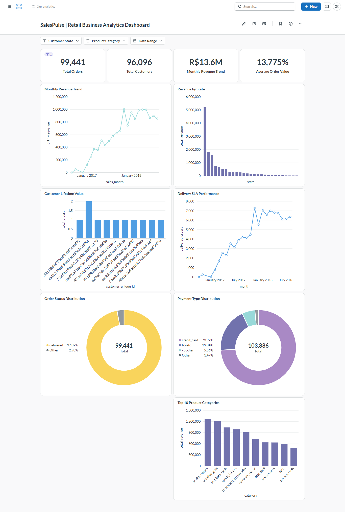

# SalesPulse — Business Intelligence Dashboard Overview

## 1. Executive Summary

The **SalesPulse Business Intelligence Dashboard** translates the underlying 1.55-million-row PostgreSQL relational database into an intuitive, interactive analytical command center. Built and visualized in **Metabase** (and fully compatible with Power BI, Tableau, and Apache Superset), the dashboard empowers commercial leaders, operations managers, and merchandising directors to monitor retail velocity, logistics compliance, and customer retention metrics.


*Figure 1: SalesPulse Interactive Executive Business Intelligence Dashboard in Metabase.*

---

## 2. Dashboard Architecture & Information Hierarchy

The dashboard is structured into four functional tiers:

```
┌────────────────────────────────────────────────────────────────────────┐
│                        1. Executive KPI Scorecard                      │
│   [ Total Revenue ]   [ Paid Orders ]   [ Average Order Value ]   [ On-Time Rate ]  │
│      R$ 16.01M            99,440               R$ 160.99               91.89%       │
└───────────────────────────────────┬────────────────────────────────────┘
                                    │
    ┌───────────────────────────────┴───────────────────────────────┐
    │                                                               │
    ▼                                                               ▼
┌──────────────────────────────────────┐  ┌──────────────────────────────────────┐
│  2. Commercial Growth & Seasonality  │  │   3. Category & Product Economics    │
│  • Monthly Revenue Trajectory        │  │  • Top 10 Revenue Product Categories │
│  • Month-over-Month Growth Velocity  │  │  • Average Selling Price by Category │
│  • Day-of-Week Order Distribution    │  │  • Freight Cost vs. Product Price    │
└──────────────────┬───────────────────┘  └──────────────────┬───────────────────┘
                   │                                         │
                   └────────────────────┬────────────────────┘
                                        │
                                        ▼
┌────────────────────────────────────────────────────────────────────────┐
│                   4. Operational SLAs & Customer Retention             │
│  • Delivery On-Time Rate vs. Customer Review Score (4.29 vs. 2.57)      │
│  • Customer Repeat Purchase Concentration (3.12% Retention Rate)       │
│  • Geographic Sales Distribution by Brazilian State (SP 38.28%)        │
│  • Payment Method Volume Breakdown (Credit Card 78.34%, Boleto 17.92%) │
└────────────────────────────────────────────────────────────────────────┘
```

---

## 3. Visual Components & Underlying Queries

All visual tiles are powered by the SQL queries cataloged in [`dashboard/dashboard_queries.sql`](dashboard_queries.sql):

### Tier 1: Executive KPI Scorecard
The analytics platform clearly delineates commercial revenue, order, and customer definitions:
- **Merchandise GMV**: `R$ 13,591,643.70` — Calculated as `SUM(order_items.price)`, representing pure product merchandise sales across all 112,650 line items across 98,666 orders (excluding freight). Covers all items recorded regardless of order status (delivered: R$ 13.22M, shipped: R$ 150.7k, canceled: R$ 95.2k, invoiced: R$ 61.5k, processing: R$ 60.4k, unavailable: R$ 2.0k, approved: R$ 0.2k). When scoped to complete operational months (`< '2018-09-01'`), cumulative merchandise revenue equals `R$ 13,591,498.70` (112,649 items across 98,665 orders); the exact R$ 145.00 difference is accounted for by 1 shipped order in September 2018 (`order_id: 54282e97f61c23b78330c15b154c867d`).
- **Delivered Payment Revenue**: `R$ 15,422,461.77` — Calculated as `SUM(order_payments.payment_value)` for `order_status = 'delivered'`, representing total customer payments (item value + freight fees) collected on delivered orders (96,477 delivered orders with payments).
- **Total Platform Payment Volume**: `R$ 16,008,872.12` (~16.01M BRL) across all historical payment transactions (`SUM(order_payments.payment_value)`) across 99,440 paid orders.
- **Total Placed Orders**: `99,441` orders registered across all 8 lifecycle statuses (96,478 delivered, 97.02%).
- **Delivered Orders**: `96,478` orders successfully fulfilled and delivered.
- **Average Order Value (AOV)**:
  - **Merchandise Basket AOV**: `R$ 137.75` per item-associated order (`R$ 13,591,643.70 / 98,666 orders`).
  - **Delivered Payment AOV**: `R$ 159.86` per delivered paid order (`R$ 15,422,461.77 / 96,477 orders`).
  - **Gross Payment AOV**: `R$ 160.99` per paid order (`R$ 16,008,872.12 / 99,440 orders`).
- **Total Customers**: `96,096` unique individual buyers (`customer_unique_id`), distinct from `99,441` order session tokens (`customer_id`).
- **On-Time Delivery SLA**: `91.89%` of evaluated delivered packages arrived on or before promised estimated dates (88,649 / 96,470 orders).

### Tier 2: Revenue Velocity & Seasonality
- **Monthly Sales Trend Line**: Tracks revenue acceleration from October 2016 through August 2018, highlighting Black Friday peaks in November 2017 (`R$ 1,194,482.80`).
- **Month-over-Month Growth**: Bar visual detailing percentage swings to pinpoint seasonal demand contractions and expansion periods.
- **Incomplete Months Cutoff Policy**: All monthly trend charts enforce August 2018 as the final calendar month (`order_purchase_timestamp < '2018-09-01'`). September and October 2018 contain only 20 orders total due to dataset truncation, so excluding them prevents artificial drops and ensures genuine business trend representation.
- **Day of Week Purchasing Heatmap**: Reveals purchase concentration on Mondays and Tuesdays, tapering off on weekends.

### Tier 3: Merchandising & Product Analytics
- **Top 10 Product Categories**: Ranked horizontal bar chart featuring `health_beauty` (R$ 1.26M), `watches_gifts` (R$ 1.21M), and `bed_bath_table` (R$ 1.04M).
- **Price Elasticity by Category**: Compares units sold against average item ticket size to isolate high-volume vs. high-margin categories.

### Tier 4: Operations, Logistics & Customer Retention
- **Logistics Impact on Customer Sentiment**: Dual-bar comparison demonstrating that on-time orders maintain an average rating of **4.29 / 5.0**, whereas delayed orders plunge to **2.57 / 5.0** (a 40% satisfaction drop).
- **Geographic Penetration (State Distribution)**: Map and ranked visual establishing that the state of São Paulo (`SP`) represents **38.28%** of merchandise revenue, with the Southeast region (`SP`, `RJ`, `MG`) accounting for **63.36%**.
- **Payment Method Distribution**: Donut chart illustrating credit card dominance (**78.34%** of payment value) followed by Boleto Bancário (**17.92%**).
- **Customer Repeat Purchase Rate**: Donut card highlighting the 3.12% repeat rate (2,997 repeat buyers out of 96,096 unique customers).

---

## 4. Interactive Filters & Dashboard Controls

The dashboard is configured with four global filter parameters:
1. **Date Range Filter**: Filter all cards by custom purchase dates (e.g., Year 2017, Q4 2017, Year 2018).
2. **Customer State Multi-Select**: Filter by federative units (e.g., `SP`, `RJ`, `MG`, `RS`, `PR`).
3. **Product Category Dropdown**: Filter specific product categories (in English via `category_translation`).
4. **Payment Type Selector**: Filter by `credit_card`, `boleto`, `voucher`, or `debit_card`.

---

## 5. Local Setup & Reproduction in Metabase

1. Ensure the PostgreSQL `salespulse` database is active.
2. Launch Metabase (via Docker or standalone JAR):
   ```bash
   java -jar metabase.jar
   ```
3. In Metabase Admin settings, add a new database connection:
   - **Database type**: PostgreSQL
   - **Host**: `localhost`
   - **Port**: `5432`
   - **Database name**: `salespulse`
   - **Username**: `postgres`
   - **Password**: `[Your local password]`
4. Import or execute the queries from [`dashboard/dashboard_queries.sql`](dashboard_queries.sql) and assemble the visual cards onto a shared dashboard canvas.

---

## 6. Live Dashboard Access & Public Demonstration

- **YouTube Video Walkthrough**: [Watch SalesPulse Demo on YouTube](https://youtu.be/JfchSQo9VEQ)
- **Metabase Public Dashboard Link**: `[METABASE_PUBLIC_DASHBOARD_URL_PLACEHOLDER]` *(To enable public access in your Metabase instance: navigate to Dashboard Settings → Sharing and Embedding → Enable Public Sharing → Copy Public Link).*
